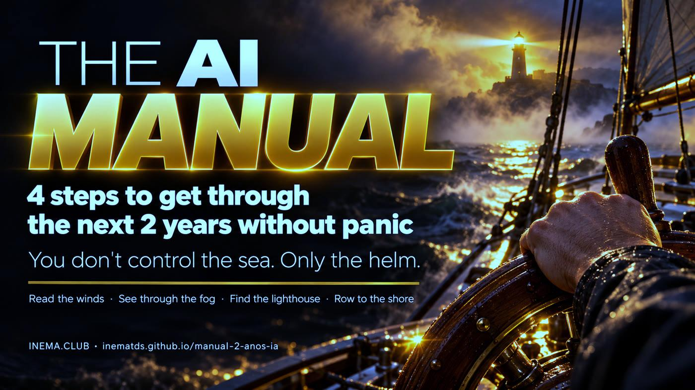

# manual-2-anos-ia

[](https://inematds.github.io/manual-2-anos-ia/guia/en/)

**🇧🇷 [Português](README.md) · 🇺🇸 [English](README.en.md) · 🇪🇸 [Español](README.es.md)**

## What it is

This is a short manual for people who feel anxious about artificial intelligence news. It organizes the subject into 4 steps: understand what happened, know who is speaking and why, assess what is changing in your work, and take small steps. It includes 5 simple tools that run on your computer without an internet connection, as well as step-by-step instructions for creating a similar manual for your family, team, or school. To read it, just open the page; to use the tools, you just need Python 3.

## 📖 User guide

Complete guide (landing page + step-by-step instructions): **https://inematds.github.io/manual-2-anos-ia/guia/en/**

## The method: 4 steps (you don't control the sea, only the helm)

| Step | Question | Tool |
|---|---|---|
| 1. [Understand the winds](manual/01-entender-os-ventos.md) (in Portuguese) | What happened? | `campo.py` |
| 2. [See through the fog](manual/02-ver-atraves-da-nevoa.md) (in Portuguese) | Who is speaking, and why? (3 fields + government, The Window) | `janela.py`, `campo.py` |
| 3. [Find the lighthouse](manual/03-achar-o-farol.md) (in Portuguese) | What is changing in MY work? (TLC model) | `tlc.py` |
| 4. [Row to shore](manual/04-remar-ate-a-praia.md) (in Portuguese) | What should I do now? | `tarefa_dia.py`, `contribuicao.py` |

One-page version for printing: **[manual/MANUAL.md](manual/MANUAL.md)** (in Portuguese).
How to create your own manual (process + tools): **[COMO-CRIAR-O-MANUAL.md](COMO-CRIAR-O-MANUAL.md)** (in Portuguese).

## Structure

```
manual/                  the manual (1 file per step + one-page MANUAL.md)
ferramentas/             5 tools in Python 3, no dependencies, no internet
  janela.py              The Window: note headlines and read them at a set time
  campo.py               news reading card (field, incentive, fact × assumption)
  tlc.py                 TLC model: Trust, Learn, Contact
  tarefa_dia.py          one task per day with AI + sequence
  contribuicao.py        your contribution + 4-week plan
  tests/                 16 tests (python3 -m unittest)
COMO-CRIAR-O-MANUAL.md   how to turn a topic into a manual + videos + tools
guia/                    landing page + guide (PT, en/, es/) on GitHub Pages
```

## The process, from start to finish

🧠 session with Nei · ⚙️ script · 🤖 agent

| # | Step | Command | Who |
|---|---|---|---|
| 1 | Choose the topic and reference; decide what problem the manual solves | conversation | 🧠 |
| 2 | Download and transcribe the reference | `python baixar_v1.py --url <URL>` · `python transcrever_v1.py --in <video>` (inemavox) | ⚙️ |
| 3 | Extract the steps, metaphor, and examples; check facts against sources | agent reading the transcript + web search | 🤖 |
| 4 | Write the manual in `manual/` | Markdown editing | 🤖 + 🧠 reviews |
| 5 | Write the tools and tests | `python3 -m unittest` | 🤖 |
| 6 | Cover and banners (PT/EN/ES) | `gerar-capa.cjs` + `gerar-banner.sh --estilo live\|grade --lang pt\|en\|es` (Codex image_gen) and `cor_neutra.py corrigir` | 🤖 |
| 7 | PT guide in `guia/index.html` | skill `projetos-landing-guia` | 🤖 |
| 8 | Translate the guide and README into EN/ES | `inema-traduz` (central translator) | ⚙️ |
| 9 | Independent reviewer | new agent with the fixed checklist | 🤖 |
| 10 | Publish the repo and Pages | `git push` (Pages via GitHub Actions) | ⚙️ |
| 11 | inema.club portal + inemabuscas + PRO | skill `atualiza-portal` | 🤖 |
| 12 | 16:9 and 9:16 explainer videos on the same topic | explicavideos + HeyGen studio (another session) | 🤖 + 🧠 approves |

## Run the tools

```bash
git clone https://github.com/inematds/manual-2-anos-ia && cd manual-2-anos-ia
python3 -m unittest                     # 16 tests, should pass
cd ferramentas
python3 janela.py add "headline" --campo seguranca
python3 janela.py listar
python3 tlc.py "My task" --confianca s --aprende n --contato n
python3 campo.py                        # interactive mode
python3 tarefa_dia.py feito "asked AI to summarize an email"
python3 contribuicao.py plano 1 --para "my parents"
```

Data is stored in `~/.manual-ia/` (change it with `MANUAL_IA_DADOS=/outra/pasta` or `--arquivo`).

## Companion resource

Practical kit (14 days, offline AI, account security, evaluating your work with AI):
**[sobreviver-ia](https://inematds.github.io/sobreviver-ia/guia/en/)**.

---

Open and free content from **[INEMA.CLUB](https://inema.club)** · MIT License.