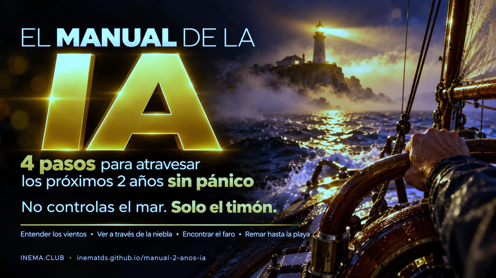

# manual-2-anos-ia

[](https://inematds.github.io/manual-2-anos-ia/guia/es/)

**🇧🇷 [Português](README.md) · 🇺🇸 [English](README.en.md) · 🇪🇸 [Español](README.es.md)**

## Qué es

Este es un manual breve para quienes sienten ansiedad ante las noticias sobre inteligencia artificial. Organiza el tema en 4 pasos: entender qué pasó, saber quién habla y por qué, medir qué cambia en tu trabajo y actuar en pequeñas dosis. Incluye 5 herramientas sencillas que funcionan en tu computadora sin internet, y los pasos para crear un manual parecido para tu familia, equipo o escuela. Para leerlo, solo tienes que abrir la página; para usar las herramientas, basta con tener Python 3.

## 📖 Guía de uso

Guía completa (landing + paso a paso): **https://inematds.github.io/manual-2-anos-ia/guia/es/**

## 🎬 Videos

- **Completo (16:9, ≈6 min, en portugués):** https://www.youtube.com/watch?v=DnkFeQDB8AI
- **Corto (9:16, 41 s, en portugués):** https://www.youtube.com/watch?v=XFDDBRPuvwE

## El método: 4 pasos (no controlas el mar, solo el timón)

| Paso | Pregunta | Herramienta |
|---|---|---|
| 1. [Entender los vientos](manual/01-entender-os-ventos.md) (en portugués) | ¿Qué pasó? | `campo.py` |
| 2. [Ver a través de la niebla](manual/02-ver-atraves-da-nevoa.md) (en portugués) | ¿Quién habla y por qué? (3 campos + gobierno, La Ventana) | `janela.py`, `campo.py` |
| 3. [Encontrar el faro](manual/03-achar-o-farol.md) (en portugués) | ¿Qué cambia en MI trabajo? (modelo TLC) | `tlc.py` |
| 4. [Remar hasta la playa](manual/04-remar-ate-a-praia.md) (en portugués) | ¿Qué hago ahora? | `tarefa_dia.py`, `contribuicao.py` |

Versión de una página para imprimir: **[manual/MANUAL.md](manual/MANUAL.md)** (en portugués).
Cómo crear tu propio manual (proceso + herramientas): **[COMO-CRIAR-O-MANUAL.md](COMO-CRIAR-O-MANUAL.md)** (en portugués).

## Estructura

```
manual/                  el manual (1 archivo por paso + MANUAL.md de una página)
ferramentas/             5 herramientas en Python 3, sin dependencias ni internet
  janela.py              La Ventana: anotar titulares y leerlos en un horario fijo
  campo.py               tarjeta de lectura de noticias (campo, incentivo, hecho × suposición)
  tlc.py                 modelo TLC: Confianza, Aprendizaje, Contacto
  tarefa_dia.py          una tarea diaria con IA + secuencia
  contribuicao.py        tu contribución + plan de 4 semanas
  tests/                 16 pruebas (python3 -m unittest)
COMO-CRIAR-O-MANUAL.md   cómo convertir un tema en manual + videos + herramientas
guia/                    landing + guía (PT, en/, es/) en GitHub Pages
```

## El proceso, de principio a fin

🧠 sesión con Nei · ⚙️ script · 🤖 agente

| # | Paso | Comando | Quién |
|---|---|---|---|
| 1 | Elegir el tema y la referencia; decidir qué resuelve el manual | conversación | 🧠 |
| 2 | Descargar y transcribir la referencia | `python baixar_v1.py --url <URL>` · `python transcrever_v1.py --in <video>` (inemavox) | ⚙️ |
| 3 | Extraer los pasos, la metáfora y los ejemplos; verificar los hechos con una fuente | agente que lee la transcripción + búsqueda en la web | 🤖 |
| 4 | Escribir el manual en `manual/` | edición en Markdown | 🤖 + 🧠 revisa |
| 5 | Escribir las herramientas y las pruebas | `python3 -m unittest` | 🤖 |
| 6 | Portada y banners (PT/EN/ES) | `gerar-capa.cjs` + `gerar-banner.sh --estilo live\|grade --lang pt\|en\|es` (Codex image_gen) y `cor_neutra.py corrigir` | 🤖 |
| 7 | Guía PT en `guia/index.html` | skill `projetos-landing-guia` | 🤖 |
| 8 | Traducir la guía y el README a EN/ES | `inema-traduz` (traductor central) | ⚙️ |
| 9 | Revisión independiente | agente nuevo con la lista fija | 🤖 |
| 10 | Publicar el repo y Pages | `git push` (Pages mediante GitHub Actions) | ⚙️ |
| 11 | Portal inema.club + inemabuscas + PRO | skill `atualiza-portal` | 🤖 |
| 12 | Videos explicativos 16:9 y 9:16 sobre el mismo tema | explicavideos + estudio HeyGen (otra sesión) | 🤖 + 🧠 aprueba |

## Ejecutar las herramientas

```bash
git clone https://github.com/inematds/manual-2-anos-ia && cd manual-2-anos-ia
python3 -m unittest                     # 16 pruebas, debe dar OK
cd ferramentas
python3 janela.py add "manchete" --campo seguranca
python3 janela.py listar
python3 tlc.py "Minha tarefa" --confianca s --aprende n --contato n
python3 campo.py                        # modo interactivo
python3 tarefa_dia.py feito "pedi para a IA resumir um e-mail"
python3 contribuicao.py plano 1 --para "meus pais"
```

Los datos quedan en `~/.manual-ia/` (cámbialo con `MANUAL_IA_DADOS=/outra/pasta` o `--arquivo`).

## Complemento

Kit práctico (14 días, IA sin conexión, seguridad de cuentas, evaluación de tu trabajo con IA):
**[sobreviver-ia](https://inematds.github.io/sobreviver-ia/guia/es/)**.

---

Contenido abierto y gratuito de **[INEMA.CLUB](https://inema.club)** · Licencia MIT.